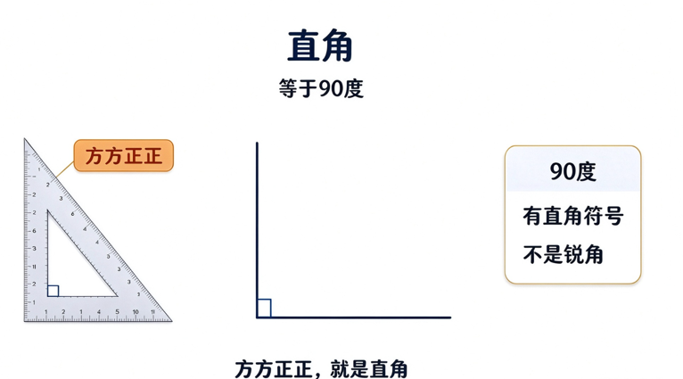
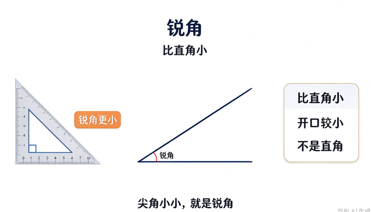
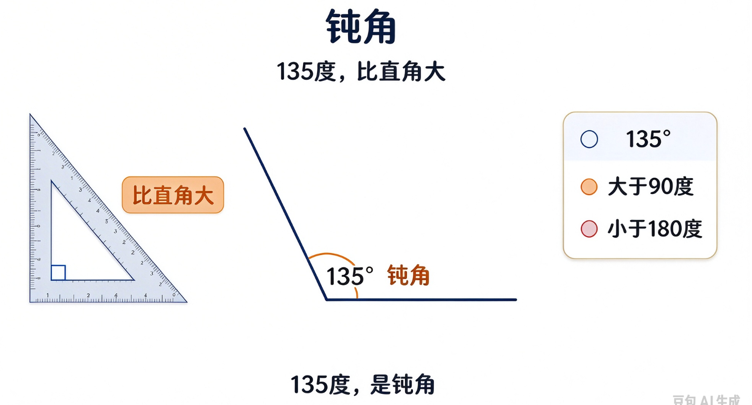
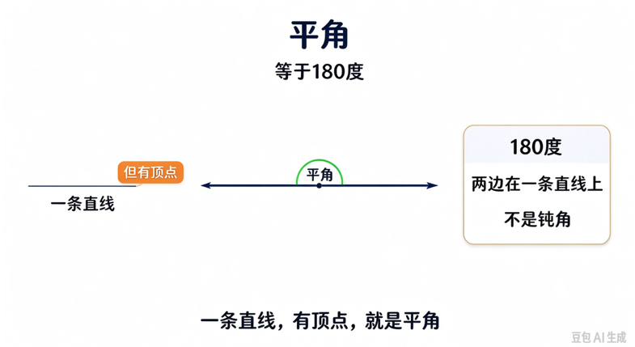
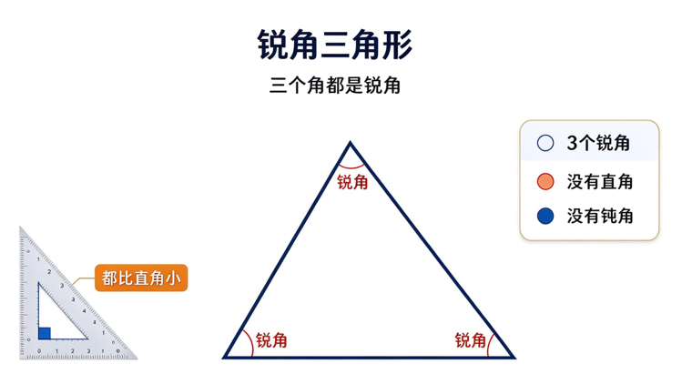
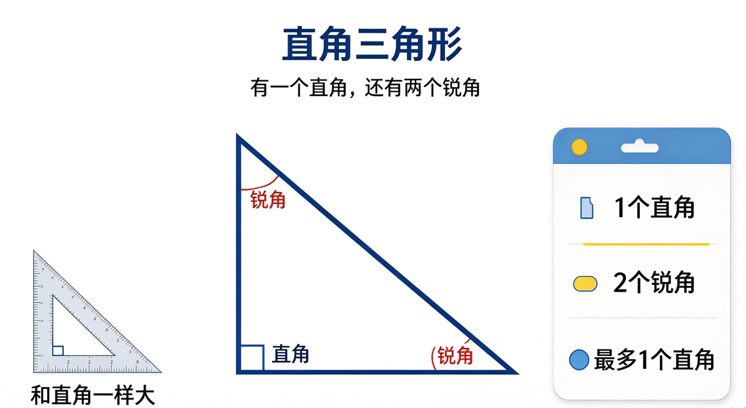
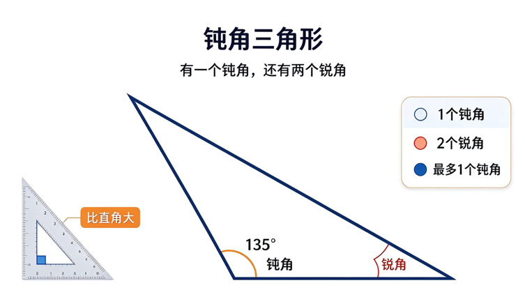
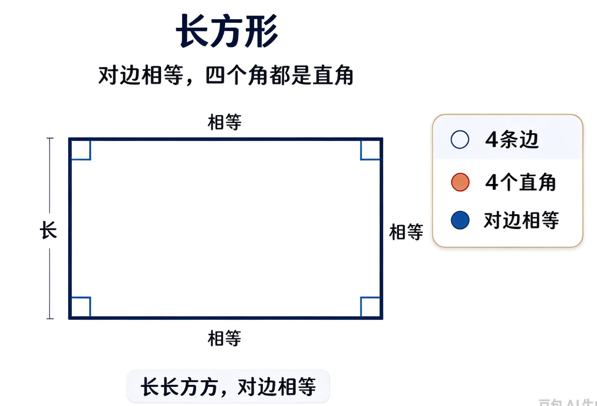
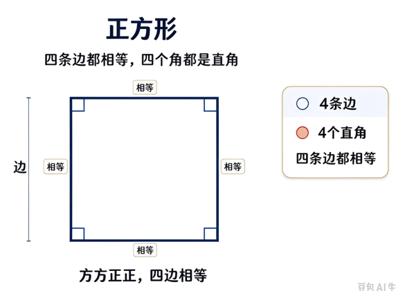

# 三角形与四边形

## 角

### 定义

1. 两条边，并且是直边
2. 一个公共点

由1和2组成的图形叫做角。

### 类型

一共有三种类型的角：

1. 直角
    - 角度: 90°
    - 
2. 锐角
    - 角度: 小于90°
    - 
3. 钝角
    - 角度: 大于90°但小于180°
    - 
4. 平角
    - 角度: 180°
    - 

问题: 找一个视频动态展示角度的变化？

## 三角形

### 定义

1. 三角形有三条边和三个角

### 类型

1. 锐角三角形
    - 三个角都是锐角
    - 
2. 直角三角形
    - 有一个角是直角
    - 
3. 钝角三角形
    - 有一个角是钝角
    - 

## 四边形

### 定义

1. 四边形有四条边和四个角

### 类型

1. 长方形
    - 四个角都是直角
    - 对边相等
    - 

2. 正方形
    - 四个角都是直角
    - 四条边相等
    - 